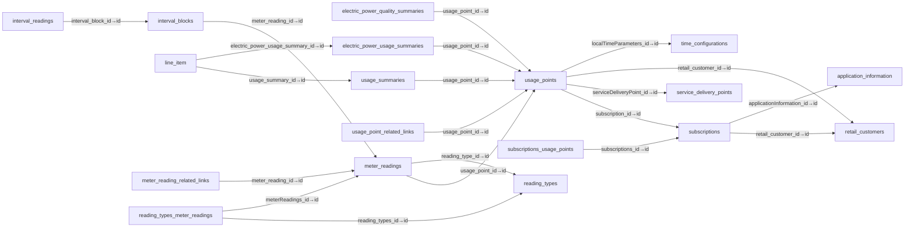
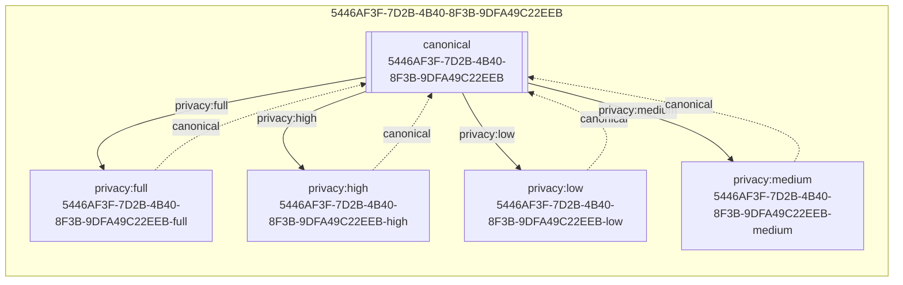

# OpenESPI Database Graphs

This folder contains auto-generated graphs for the dev MySQL database.

## 1) Schema topology (FK graph)

## 2) Privacy variant linkages (live data)

## 3) Data sharing flow (context, start → finish)

Open and view in the HTML viewer (recommended):

- `view.html` (served locally)

Or read the Mermaid source:

- `flow_consent_to_data.mmd`

## 4) Privacy selection → exported data

- `flow_privacy_variant_selection.mmd`

## Regenerating

These files are generated from your live MySQL state:

- `dc_schema_focus.dot` / `dc_schema_focus.mmd`
- `dc_privacy.dot` / `dc_privacy.mmd`

Run:

- `MYSQL_USER=root MYSQL_PASS=password OpenESPI-Common-java/bin/db_graph.py schema --filter 'usage_points|usage_point_related_links|subscriptions|retail_customers|meter_readings|interval_blocks|reading_types|usage_summaries' --out-dot OpenESPI-Common-java/docs/graphs/dc_schema_focus.dot --out-mmd OpenESPI-Common-java/docs/graphs/dc_schema_focus.mmd`
- `MYSQL_USER=root MYSQL_PASS=password OpenESPI-Common-java/bin/db_graph.py privacy --out-dot OpenESPI-Common-java/docs/graphs/dc_privacy.dot --out-mmd OpenESPI-Common-java/docs/graphs/dc_privacy.mmd`

If you want polished SVG/PNG exports, install Graphviz (`dot`) and render the `.dot` files.
